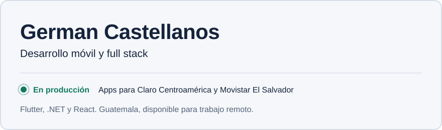

<picture>
  <source media="(prefers-color-scheme: dark)" srcset="./assets/ficha-oscuro.svg">
  
</picture>

Construyo aplicaciones móviles y sistemas web que funcionan en producción, para empresas que atienden a muchas personas todos los días. Me hago cargo de módulos completos: desde la arquitectura hasta que la app se conecta con el resto del sistema.

**¿Tienes un proyecto?** Escríbeme a [germancastellanose@gmail.com](mailto:germancastellanose@gmail.com) o por [LinkedIn](https://linkedin.com/in/germancast-gtm).

## Lo que entrego

- **Apps móviles en producción.** Flutter y Dart, con Riverpod y Clean Architecture. Integración nativa en Kotlin y Swift cuando la app necesita algo del teléfono que Flutter no resuelve solo.
- **APIs y backends.** .NET y C# con Entity Framework, bases de datos PostgreSQL y MySQL, y APIs REST que otras aplicaciones consumen.
- **Aplicaciones web.** React, Angular y TypeScript, para paneles y herramientas internas.

## Dónde ha corrido mi código

Desde hace más de dos años construyo apps móviles corporativas en Flutter para clientes de telecomunicaciones de alto tráfico en Centroamérica, en proyectos para **Claro Centroamérica** y **Movistar El Salvador**. Ahí he liderado la implementación de módulos completos, desde la arquitectura hasta la integración con APIs REST.

Esos proyectos son confidenciales; con gusto te cuento cómo trabajé en ellos en una conversación.

## Cómo trabajo

- **Arquitectura por capas desde el inicio**, para que el proyecto pueda crecer y otra persona lo entienda y lo mantenga.
- **Módulos completos, no piezas sueltas:** la pantalla, el estado, la integración y los casos de error.
- **Siempre mejorando:** hoy estoy profundizando en pruebas automatizadas y CI/CD para Flutter.

## Proyectos públicos

| Proyecto | Qué es | Con qué |
|---|---|---|
| [world-cup](https://github.com/germanCAST/world-cup) | App del Mundial 2026 | Flutter, Dart |
| [clean-arch-cs](https://github.com/germanCAST/clean-arch-cs) | Buscador de cartas de Yu-Gi-Oh! con Clean Architecture | C#, .NET |
| [qa-lite](https://github.com/germanCAST/qa-lite) y su [backend](https://github.com/germanCAST/qa-lite-backend) | Plataforma de gestión de pruebas y control de calidad | React, TypeScript, Node.js |
| [reportes-web](https://github.com/germanCAST/reportes-web) | Reportes de soporte técnico con generación de PDF | Angular, TypeScript |

## Formación

Ingeniería en Sistemas de Información, Universidad Mariano Gálvez de Guatemala (en etapa de tesis).
